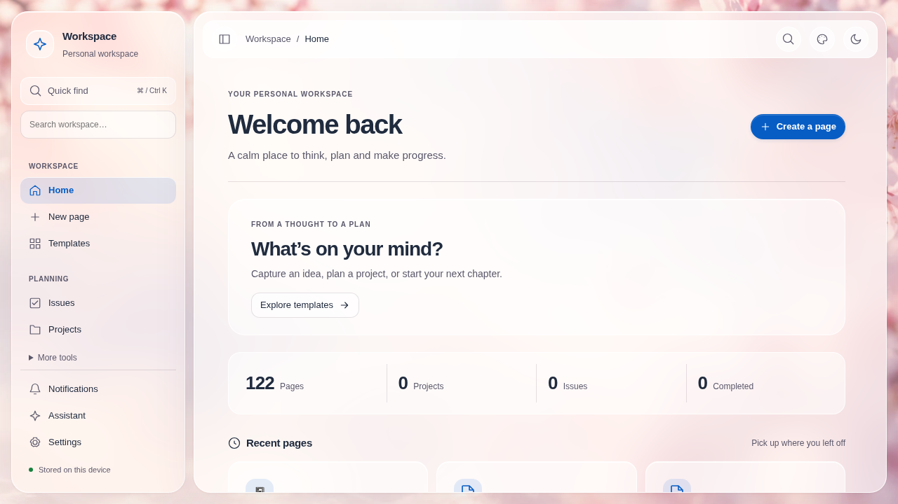
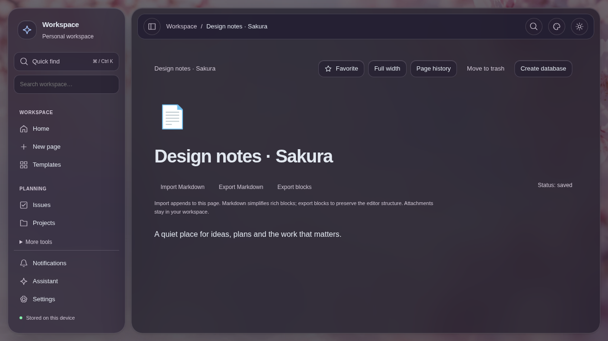
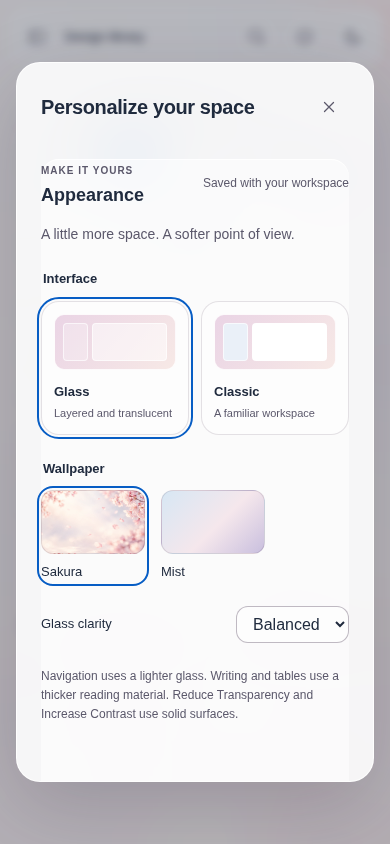

# Glass v2 — native browser evidence

Source: `4ba302006fcc94e77a006a5311abd492019a6902`.
[CI 41186824795](https://github.com/Lin-Silver/Reverie-Planner/actions/runs/41186824795),
Linux UI artifact `13037690396`. The PNG files are copied directly from that
artifact without visual changes. They use saved synthetic records in an isolated
test workspace, never the owner's private workspace. System glass preferences
are explicitly emulated for this visual test; solid-material overrides have
separate regressions. This is Chromium evidence on a native runner, not a Safari,
AppKit or manual hardware acceptance claim.

See [design and generated wallpaper provenance](../../GLASS_UI_V2.md) and
[exact verification results](../../DEVELOPMENT_PLAN.md).
